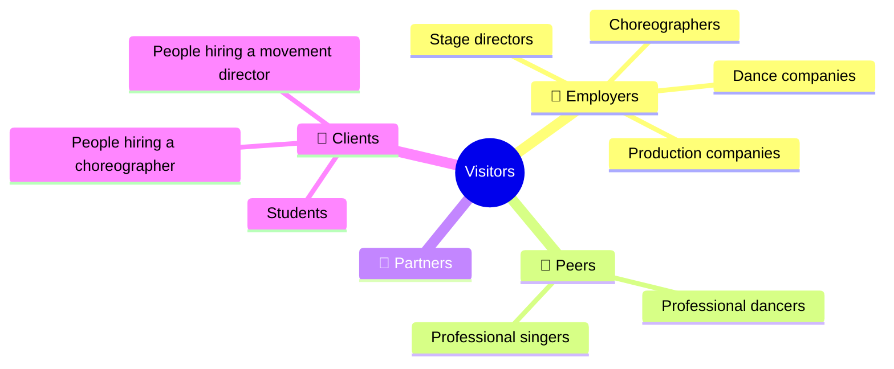
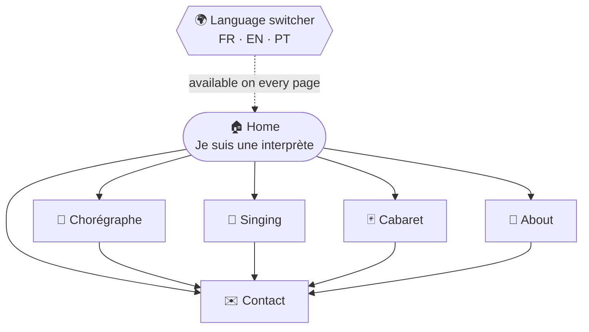
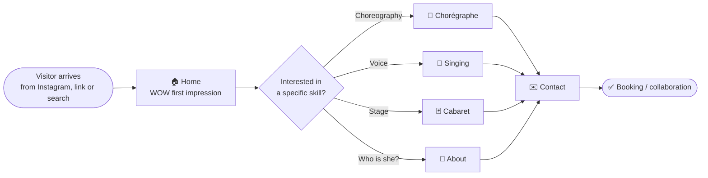
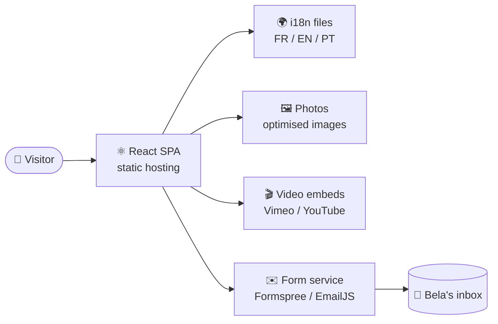
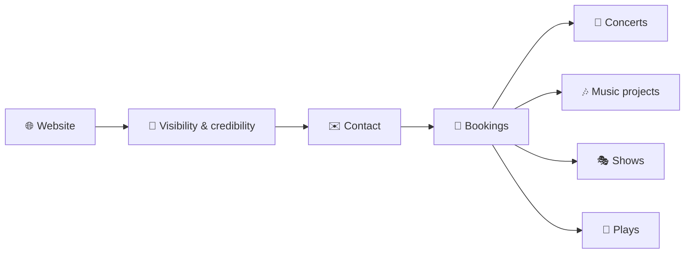

# 🎭 Bela Balsa — Website Project Overview

> **One-liner:** A moving, professional portfolio site that shows every side of Bela's work (dance, choreography, singing, cabaret) in one place, so the right professionals find her and get in touch.

| | |
|---|---|
| **Status** | 📝 Planning |
| **Stack** | ⚛️ React (no database) |
| **Languages** | 🇫🇷 French (default) · 🇬🇧 English · 🇧🇷 Portuguese |
| **Visual reference** | [joranerest.com](https://www.joranerest.com/) |
| **Docs & context** | _TBD_ |

---

## 📑 Table of Contents

1. [Problem](#-problem)
2. [Goals](#-goals)
3. [Users](#-users)
4. [Features (MVP)](#-features-mvp)
5. [Site Map & User Flow](#-site-map--user-flow)
6. [UI / UX Direction](#-ui--ux-direction)
7. [Tech](#-tech)
8. [Data](#-data)
9. [Monetization](#-monetization)
10. [Open Questions & Next Steps](#-open-questions--next-steps)

---

## 🎯 Problem

Bela is a multi-disciplinary performer: **dancing, singing, acting, choreography, cabaret…**

- 📱 **Instagram only works for one activity at a time.** It can't present several disciplines in clearly separated sections.
- 🌐 She needs a single place on the web where people can quickly grasp the full range of her work.
- 📬 Visitors must be able to **contact her** easily.
- 🤝 The site should **attract professionals** who want to work with or for her.
- ⚡ It should show that she is **still very active**.

## ✅ Goals

| # | Goal | How the site delivers it |
|---|------|--------------------------|
| 1 | Showcase many disciplines | One dedicated section ("compartiment") per activity |
| 2 | Look like a pro | Polished, cinematic design, high-quality media |
| 3 | Generate opportunities | Clear, always-reachable contact path |
| 4 | Prove ongoing activity | Recent work visible, easy to update |
| 5 | Reach a French-first audience | FR default, plus EN and PT |

---

## 👥 Users

Primarily a **French-speaking** audience.

| Persona | What they want to know | Where they land |
|---|---|---|
| 🎬 **Employer** (choreographer, director, production, company) | Can she perform at the level we need? Is she active and available? | Home, Contact |
| 💃🎤 **Fellow professional** | What's her work and style? | Home, Choreographer, Singing |
| 🤝 **Partner** | Is she credible and professional? | About, Contact |
| 🙋 **Client** (students, commissions) | Can she teach or choreograph for me? | Choreographer, Contact |

---

## 🧩 Features (MVP)

| Icon | Page | Content |
|---|---|---|
| 🏠 | **Home** — _"Je suis une interprète"_ | Photos and videos of **her only**; the strongest first impression |
| 💃 | **Chorégraphe** | Photos and videos of her work **and of others she has helped**. Reference: [joranerest.com/personal-work](https://www.joranerest.com/personal-work) |
| 🎤 | **Singing** | Singing showcase |
| 🃏 | **Cabaret** | Cabaret showcase |
| 👤 | **About** | Short bio |
| 🌍 | **Languages** | French by default, with English and Portuguese |
| ✉️ | **Contact** | Email, social platforms, contact form |

---

## 🗺️ Site Map & User Flow

### Site map

### Visitor journey

---

## 🎨 UI / UX Direction

- 🤩 **"WOAW!!!"** — the first screen has to stop people in their tracks
- 🎞️ **Sensitive, moving, touching** — emotion first, content second
- 🏆 **Professional** — she is a pro and the site should say so
- 🌈 **Range, done well** — she does a lot of things and does them very well, so each section feels distinct but part of one identity
- 🔗 **Reference:** [joranerest.com](https://www.joranerest.com/)

### Design principles

| Principle | In practice |
|---|---|
| 📸 Media-led | Full-bleed photos and video, minimal text |
| 🧭 Easy navigation | Clear entry to each "compartiment" from the home page |
| 📱 Mobile-first | Most visitors will arrive from Instagram on a phone |
| ⚡ Fast | Lazy-load media; heavy video must not slow the site |
| ♿ Accessible | Readable contrast, keyboard navigation, alt text |

---

## 🛠️ Tech

| Area | Choice | Notes |
|---|---|---|
| Framework | ⚛️ [React](https://react.dev) | From the spec |
| Data | 🚫 No database | Content stored in static files (JSON / i18n files) |

### 💡 Suggestions (not yet decided)

| Need | Suggestion | Why |
|---|---|---|
| Build tool | [Vite](https://vite.dev) | Fast setup for a static React site |
| Translations | [react-i18next](https://react.i18next.com) | Handles FR / EN / PT with French as default |
| Animation | [Motion (Framer Motion)](https://motion.dev) | Helps deliver the "moving / touching" feel |
| Video | [Vimeo](https://vimeo.com) or YouTube embeds | Avoids hosting heavy video files yourself |
| Contact form | [Formspree](https://formspree.io) or EmailJS | Form works without writing a backend |
| Hosting | [Netlify](https://www.netlify.com) or [Vercel](https://vercel.com) | Free tier, simple deploys, custom domain |

### Architecture (no backend)

---

## 🗄️ Data

- **No database for now.**
- All content (text, translations, media lists) lives in the codebase.
- ➡️ Updating the site means editing files and redeploying. A lightweight CMS could come later if Bela wants to update it herself.

---

## 💶 Monetization

The site doesn't earn money directly. It is a **lead-generation tool** that leads to paid work:

---

## ❓ Open Questions & Next Steps

### Open questions

- [ ] **Brand:** logo, colours, typography? Are there existing brand assets?
- [ ] **Content:** who provides the photos, videos and bio, and by when? Is professional-quality media available for every section?
- [ ] **Acting:** the Problem section lists acting, but the MVP has no Acting page. Is it covered by Home, or should it be added later?
- [ ] **Cabaret & Singing:** what's the specific content for each (videos, dates, venues)?
- [ ] **Proof of activity:** add a news / upcoming-shows block, or is that post-MVP?
- [ ] **Domain name:** is `belabalsa.com` (or similar) available?
- [ ] **Contact form:** where should submissions go?
- [ ] **Translations:** who translates the text into EN and PT?
- [ ] **Legal:** is a privacy notice needed for the contact form (French audience, GDPR)?
- [ ] **Docs & context:** _TBD_

### Suggested next steps

| Step | Action |
|---|---|
| 1️⃣ | Collect content: photos, videos, bio |
| 2️⃣ | Sketch wireframes for Home and the 3 showcase pages |
| 3️⃣ | Pick a visual direction (type, colour, motion) based on the reference site |
| 4️⃣ | Scaffold the React project with i18n (FR default) |
| 5️⃣ | Build Home, then the showcase pages, About and Contact |
| 6️⃣ | Test on mobile and check performance |
| 7️⃣ | Deploy and connect the domain |

---

## 🔗 Links

- 🎨 Visual reference: [joranerest.com](https://www.joranerest.com/)
- 💃 Choreographer page reference: [joranerest.com/personal-work](https://www.joranerest.com/personal-work)
